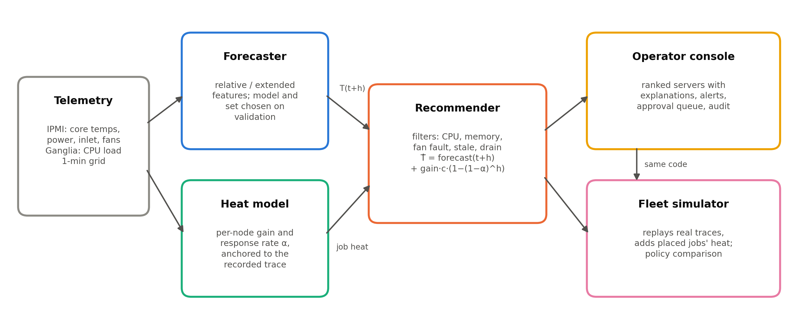
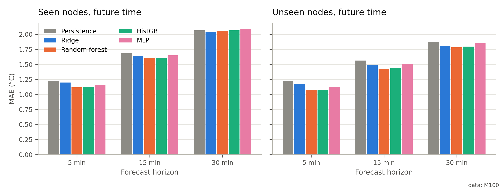
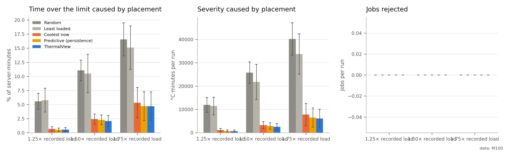

# ThermalView

**Forecast-aware workload placement for server fleets, evaluated on real supercomputer telemetry.**

[](https://github.com/Shivamk0805/thermalview/actions/workflows/tests.yml)


Data centres usually react to heat: a server is avoided only after it is already hot. But
temperature lags load by several minutes, so a server that looks cool when a job lands may
already be heading towards its limit. ThermalView forecasts each server's CPU temperature
5–30 minutes ahead and ranks servers by how hot they will be *after* the new job starts, with
an explanation for every ranking. It is decision support: it never moves real workloads.



## Results

All numbers come from 21 days of one-minute telemetry from **40 nodes of the CINECA Marconi100
supercomputer** (public [M100 ExaData](https://doi.org/10.1038/s41597-023-02174-3) dataset, CC BY 4.0).

| Question | Result |
| --- | --- |
| Does a 5-min forecast beat "temperature stays the same" (persistence)? | Random Forest cuts MAE by **8.7%** (95% block-bootstrap CI 7.1–10.2%) |
| Does it work on nodes it never saw? | **12.4%** better than persistence on held-out nodes |
| Does it survive a new month? | Frozen models keep **11.3%** skill on a month absent from all fitting |
| Are the uncertainty ranges honest? | Split-conformal 90% intervals cover **93%** of test minutes |
| Does forecast-aware placement help? | **14%** less time above the thermal limit than coolest-server-first at 1.5× load (12% at 1.75×), over 10 paired runs |

At 30 minutes no model is reliably better than persistence, because the nodes settle within
minutes of a load change. An ablation shows most of the placement gain at high load comes from
modelling the incoming job's own heat; the forecast adds a smaller share, clearest at moderate
load. Placement results come from a simulator calibrated on real data, not from hardware.

| Forecast error by model and horizon | Placement policies compared |
| --- | --- |
|  |  |

## How it works

```
M100 telemetry ─► clean 1-min table ─┬─► compare 5 forecasters ─► Random Forest ─────┐
                                     └─► fit per-node heat model ─► simulator ───────┤
                                                                                     ▼
 Live console: simulated fleet ─► SQLite ─► forecasts ─► recommender ─► web UI / API / Prometheus
```

**Evaluation done carefully**

- Chronological train/validation/test splits with a 60-minute embargo, so no future data leaks into training.
- A group of nodes withheld completely, to test generalisation to new hardware.
- Model selection on validation data only; the test set is touched once.
- Persistence, ridge regression, Random Forest, histogram gradient boosting and an MLP all compared against the same baseline.
- Block-bootstrap confidence intervals and split-conformal prediction intervals.

**Live operator console** (Starlette + vanilla JS): a simulated fleet whose servers replay real
M100 nodes, ranked placement recommendations with explanations, alerts with escalation, fault
injection, role-based accounts, a REST API for external telemetry agents (Redfish mapping
included), Prometheus metrics and a Grafana dashboard.

## Run it

```bash
git clone https://github.com/Shivamk0805/thermalview.git
cd thermalview
python -m venv .venv && source .venv/bin/activate    # Windows: .venv\Scripts\activate
pip install -r requirements.txt

python -m pytest                           # test suite
python -m thermalview all --dev --quick    # whole pipeline on synthetic data (~10 min)
python -m thermalview serve                # console at http://127.0.0.1:8000
```

Demo sign-ins are defined in `config.toml` (`operator` / `viewer`). They are for local demos
only; change them before exposing the console to anyone.

**With Docker** (console + Prometheus + Grafana), after running the pipeline once:

```bash
docker compose up --build
```

**On the real M100 data:** download a month from Zenodo
([2020](https://zenodo.org/records/7588815), [2021](https://zenodo.org/records/7589131)), extract it
into `data/raw/m100/`, then run `python -m thermalview probe` and `python -m thermalview all`
(30–90 minutes on a laptop). The data and trained models are not stored in this repo.

## Project structure

```
thermalview/          package
  data/               M100 loading and cleaning
  features.py         lag, load-shape and history features
  forecasting.py      model comparison and selection
  evaluation.py       bootstrap CIs, conformal intervals, metrics
  thermal_model.py    per-node heat response
  simulator.py        closed-loop fleet simulator
  recommender.py      forecast-aware ranking with explanations
  web/                live console and REST API
scripts/              M100 fetcher, example telemetry agent
deploy/               Prometheus and Grafana configuration
results/              result tables and figures
tests/                pytest suite (runs in GitHub Actions)
docs/                 API reference, demo walkthrough
```

## Tech stack

Python, pandas, NumPy, scikit-learn, SciPy, matplotlib, Starlette, SQLite, Docker, Prometheus,
Grafana, GitHub Actions.

## Team

Industry project at **Jio Platforms Limited**, also submitted as our B.Tech final-year project
(Department of Computer Engineering, Vishwakarma Institute of Information Technology, Pune).
The public version uses open M100 telemetry only; no Jio data or infrastructure details are included.

- Shivam Koli
- Jayendrasing Girase
- Malhar Khandekar
- Guided by Disha Wankhede and Yogesh Sharma

A research paper describing this work has been written; it will be linked here once published.

## Data and licence

Telemetry: M100 ExaData, Borghesi et al., *Scientific Data* 10 (2023),
https://doi.org/10.1038/s41597-023-02174-3, CC BY 4.0. Code: MIT licence.
